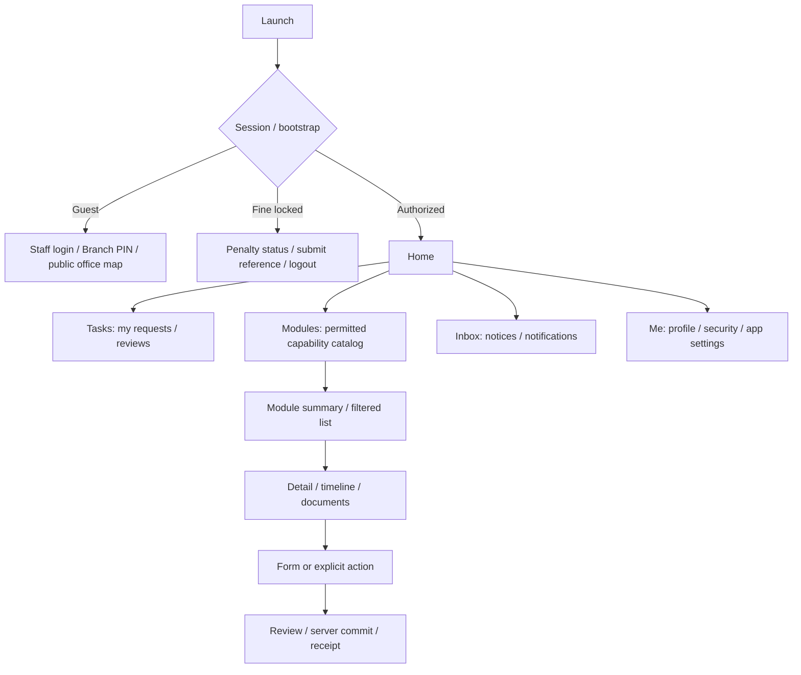

# Professional Flutter UI/UX blueprint

Design লক্ষ্য: মাঠের কর্মী দ্রুত attendance/আবেদন করবেন, manager পরিষ্কার তথ্য দেখে সিদ্ধান্ত নেবেন, HR/Accounts জটিল কাজেও ভুল কম করবেন। Existing `public/logo.png` দেখে সবুজ brand identity রাখা প্রস্তাব করা হচ্ছে; logo বিকৃত না করে licensed high-resolution asset নিতে হবে। এখানে final approved visual mockup নয়, implementable design brief ও review gates দেওয়া হলো।

## Navigation ও information architecture

Phone bottom navigation: **Home · Tasks · Modules · Inbox · Me**। Employee-এর Tasks-এ নিজের pending applications; reviewer-এর Tasks-এ actionable approvals। Context header-এ staff/branch identity এবং selected organizational scope স্পষ্ট থাকবে। Authorized scope বদলানো permission বদলানো নয়।



Tablet ≥600 logical px: NavigationRail ও list/detail layout যেখানে কাজে লাগে; ≥840px expanded pane। Breakpoint final device tests-এ যাচাই করতে হবে। Phone 360/390/412px, small 320px এবং keyboard-open layout জরুরি। Landscape/tablet support; orientation lock শুধু প্রমাণিত flow-specific প্রয়োজন হলে।

Global search প্রথমে current scope; employee ID/PIN/name দিয়ে debounce + paged results। NID, bank বা private documents global search preview-তে আসবে না। Module grid-এ ১২টি card একসঙ্গে জোর করে নয়—role-এর frequent modules আগে, বাকি searchable groups-এ।

## Design tokens: proposed baseline

| Token | Value / নিয়ম |
| --- | --- |
| Brand primary | `#087F3E`, on-primary white; contrast prototype-এ যাচাই |
| Primary subtle | `#EAF6EE` |
| Secondary/action support | `#155E75` |
| Canvas / surface | `#F6F8F7` / `#FFFFFF` |
| Text primary / secondary | `#14261C` / `#526258` |
| Border | `#D6E0D9`; essential field/control outline contrast verify |
| Status | success `#166534`, warning `#92400E`, error `#B42318`, info `#075985`; icon+label always |
| Spacing | 4, 8, 12, 16, 24, 32; phone outer margin 16 |
| Radius | field/button 12, card 16, sheet top 24 |
| Type | English: bundled licensed readable sans; বাংলা: bundled Noto Sans Bengali candidate, license review |
| Type scale | title 24–28, section 18–20, body 16, supporting 14, label ≥12; বাংলা line height 1.5–1.65 |
| Interaction | min 48×48 logical px touch target; primary button min height 52 |
| Motion | 150–250ms purposeful transitions; reduced-motion support |
| Elevation | separators/subtle shadow; strong hierarchy through spacing/type |
| Theme | light first, dark and system preference with independent contrast review |

এই values product proposals; accessibility acceptance ছাড়া approved নয়। Flutter guideline-এ সাধারণ text-এর contrast 4.5:1, বড় text-এর জন্য 3:1 এবং usable touch targets বলা আছে। [Flutter UI accessibility](https://docs.flutter.dev/ui/accessibility/ui-design-and-styling)।

## Reusable component kit

App shell, context header, module tile, summary card, key-value section, status chip, filter/search bar, paginated list, empty/error panel, offline/stale banner, primary/secondary/destructive button, bottom action bar, date/range picker, searchable organization picker, currency field, phone/ID field, attachment uploader, document viewer, workflow timeline, reviewer signature row, comment history, review sheet, operation receipt, job progress এবং accessible alert।

Component contract-এ disabled/loading/focus/error/large-text/dark variants থাকবে। Money/number right-aligned; employee identity leading; statuses শুধু colour নয়। Swipe-to-delete/gesture-only essential action নয়। Shared footer এবং dirty-form warning একই আচরণ করবে।

## মূল screen-এর detailed brief

| Screen/flow | Content hierarchy | Actions ও exceptional states |
| --- | --- | --- |
| Login | logo/title → staff/branch tabs → identifier/PIN → submit → recovery → public map | password visibility, generic error, lockout timer, inactive state; secret cache নয় |
| Home: employee | greeting/date/context → today punch status → 2–4 quick actions → my pending requests → summaries → notices | check-in dominant when eligible; stale chip/time; totals tap to detail |
| Home: reviewer | scope → actionable counts → priority tasks → team attendance/leave summary → module shortcuts | count server-derived; no forbidden financial KPI leakage |
| Attendance | date/server time → eligible branch → location status/distance/accuracy → check-in/out CTA → last receipt/history | precise permission denied, GPS off/weak, outside fence, no eligible branch, already punched, daily device lock, network uncertainty |
| Apply leave | balance/type → date range → computed days/eligibility → reason/contact/attachments → review | overlap/insufficient balance/half-day if supported/holiday handling from API; success receipt + next stage |
| Movement | official/personal → place/purpose → departure/expected return → multi-day → travel details → review | actual return completion, overlapping period, overdue penalty; log-book is distinct from request |
| Task detail | requester/context/status → relevant facts → documents → chronological stage history → allowed action bar | forward/approve/reject/send-back distinct labels; required comment; stale version reload |
| Evaluation | form type/server template → section progress → criteria/score → recommendation → preview → submit | 3 form variants where supported; drafts; signature visibility; backward revisions and corrections visible |
| Payslip | period/status → net pay → earning/deduction cards → gross/totals → official PDF | masked money preference; only authorized posted/current state; missing period clear |
| Loan | outstanding/next installment → loan type → ledger → application eligibility/preview | PF/Motorcycle dedicated forms, nomination/guarantor/docs as source; explain server rejection |
| PF/gratuity | as-of date → employee/employer contribution → interest/withdrawal → ledger/entitlement | figures labelled estimated/posted; separation status; official statement |
| Directory/detail | scoped search/filter → identity/contact/posting → tabs/groups → documents/history | NID/bank restricted; contact call confirmation where needed; lists page efficiently |
| Employee editor | grouped step wizard → required field count → repeated rows → draft → review summary | server English-only fields remain explicit; dependent geography reset; unsaved changes recovery |
| Asset | tag/name/status → branch/custodian → purchase/financial data → lifecycle timeline → attachments | transfer/assignment/maintenance/disposal contextual; scanned ID optional; not-in-use distinct |
| Inventory | branch/product → current stock → stock-in/disburse form → recipient → review | server availability recheck, insufficient stock, concurrency; undo via authorized correction |
| Reports | report catalog → scoped filters → summary/list preview → export job/status → file | long wide tables become key totals + drilldown; official PDF retained; same filter snapshot |
| Admin role editor | role identity → module/permission groups → section blocks → impact preview → confirm | avoid accidentally widening access; show affected users; re-authentication for critical changes |
| Office map | search/hierarchy → list/map switch → cluster → office card → directions/contact | public-field allowlist, no location permission until needed, list fallback on tile failure |
| Penalty lock | reason/reference → exact amount/status → transaction reference upload → verification history | pending/rejected/resubmit, inbox if allowed by policy, logout reachable; no fake paid success |

## Wireframe order: key journeys

```text
HOME (employee)                 ATTENDANCE                    APPROVAL DETAIL
┌────────────────────────┐     ┌────────────────────────┐    ┌────────────────────────┐
│ Avatar  Mousumi   Bell  │     │ Back  Today's attendance│    │ Back  Leave request     │
│ Name · Branch · Date   │     │ Server date / time     │    │ Name · Branch · Status  │
│ ┌ Today attendance ──┐ │     │ Branch + eligible scope│    │ Dates · Days · Balance  │
│ │ Not checked in     │ │     │ Location status        │    │ Reason / attachments    │
│ │ [Check in]         │ │     │ Accuracy / distance    │    │ Approval timeline       │
│ └────────────────────┘ │     │ Last accepted receipt  │    │ Reviewer comments       │
│ Leave / Movement / Pay │     │ History                │    │ Action-specific comment │
│ Pending requests       │     │                        │    │                        │
│ Recent notice          │     │ [Check in / Check out] │    │ [Send back] [Approve]  │
│ Home Tasks Modules ... │     │ Online commit required │    │ Review then confirm     │
└────────────────────────┘     └────────────────────────┘    └────────────────────────┘
```

Final design deliverables: annotated user flows, low-fidelity wireframes, high-fidelity phone/tablet layouts, token/component library, clickable prototype, screen-state matrix এবং developer handoff specs। Authoring tool যাই হোক, exported specs repository-তে versioned থাকবে। AI bitmap বা decorative hero professional workflow design-এর বিকল্প নয়।

## Forms, states এবং microcopy

প্রতি screen: initial/loading, content, empty, validation error, API failure, unauthorized, offline, stale, submitting, success ও conflict—প্রযোজ্য প্রতিটি state design করতে হবে। Missing employee/profile/config/unavailable module আলাদা state।

Forms-এ field label সবসময় দৃশ্যমান; required hint, inline error, error summary, numeric/date keyboard, sticky save/review button, step progress এবং repeated row delete confirmation। Local draft-এ identity/signature/bank data default বাদ; sensitive draft হলে encryption/TTL ও explicit policy। Field validation server-এর সমান; final rule server enforce করে।

বাংলা copy উদাহরণ: “লোকেশন পাওয়া যাচ্ছে…”, “অফিসের অনুমোদিত এলাকার বাইরে আছেন”, “নেটওয়ার্কে সমস্যা হয়েছে। জমা হয়েছে কি না যাচাই করছি”, “আপনার আবেদন জমা হয়েছে”, “অন্য একজন ইতোমধ্যে সিদ্ধান্ত দিয়েছেন। সর্বশেষ অবস্থা দেখুন।” Button-এ কাজের নাম; শুধু “OK” বা অস্পষ্ট technical error নয়।

বাংলা/ইংরেজি ARB localization; employee-provided বাংলা নাম অপরিবর্তিত; ID/PIN/account number-এর leading zeros রক্ষা। UI language বনাম field English-only requirement আলাদা। Date display `১৩ নভেম্বর ২০২৬`/`13 Nov 2026`; payload ISO। Amount BDT এবং existing Taka grouping/rounding rules; sample figures fictional।

## Accessibility ও usability acceptance

TalkBack/VoiceOver semantic labels, logical focus, announced errors/status, 200% text scaling, keyboard focus, no clipped বাংলা conjuncts, visible contrast, reduced motion, left/right-handed reach এবং low-brightness outdoor attendance পরীক্ষা হবে। Charts-এর accessible textual totals ও list alternative থাকবে।

প্রথম usability round: অন্তত ৮ জন, employee/manager/HR/accounts ও বাংলা-preferred ব্যবহারকারী মিলিয়ে। Pilot লক্ষ্য: assistance ছাড়া attendance/leave/task review-এর ≥90% completion; কোনো critical ভুল approval নয়। নতুন round-এ severe issue বন্ধ না হওয়া পর্যন্ত final UI freeze নয়। এগুলো proposed release targets, measured results নয়।
