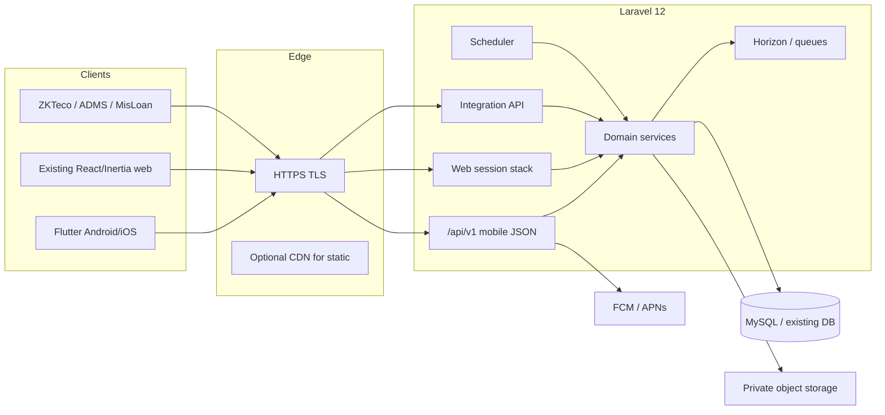

# Flutter ও API architecture

একই Laravel backend ও database থাকবে। Flutter শুধু native client; business calculation, permission, workflow এবং posting Laravel services-এ চলবে। Web Inertia page সরাসরি reuse হবে না।

## সিস্টেম চিত্র



## Repository ও app structure

প্রস্তাবিত monorepo layout (নতুন `mobile/` folder; web অপরিবর্তিত রাখা):

```text
mobile/
  apps/mousumi_hrm/          # Flutter application
  packages/
    design_system/           # tokens, theme, reusable widgets
    api_client/              # OpenAPI-generated or hand-maintained DTOs + Dio
    auth_session/            # secure storage, token refresh, biometric unlock
    localization/            # ARB bn/en
  docs/                      # exported design specs / screen-state matrix
```

Flutter feature-first modules (প্রতিটি feature-এ `data / domain / presentation`):

| Package / feature | দায়িত্ব |
| --- | --- |
| `core` | routing, DI, error mapping, logging (no PII), connectivity, feature flags |
| `auth` | staff login, branch/PIN, logout, revoke, password update, recovery |
| `shell` | bootstrap, home, bottom nav, module catalog, global search, settings |
| `tasks` | unified action inbox + per-workflow detail adapters |
| `attendance` | geofence punch, history, ops screens |
| `leave` / `movement` / `hr` / `appraisal` / `exit` | domain screens + forms |
| `loans` / `payroll` / `staff_fund` | money-sensitive UI; amounts as string/decimal |
| `employees` / `organization` | directory, editors, org structure |
| `assets` / `inventory` | lifecycle & stock ops |
| `documents` / `notices` / `office_map` | files, inbox, public map |
| `admin` | users/roles/sessions/audit (capability-gated) |
| `reports` | catalog, filters, job status, download |

State: Riverpod বা সমমানের explicit DI; presentation-এ business formula নেই। Navigation: go_router + deep-link map (notification → task/detail)।

## API surface: `/api/v1`

নতুন versioned mobile API। Existing `/api/*` integration routes (ZKTeco, MisLoan sync) আলাদা রাখা হবে; Flutter সেগুলোতে shared secret পাঠাবে না।

### Cross-cutting contract

| বিষয় | নিয়ম |
| --- | --- |
| Content type | `application/json`; multipart শুধু upload |
| Auth | `Authorization: Bearer {token}` (Sanctum personal access / custom token table) |
| Device | `X-Device-Id`, `X-App-Version`, `X-Platform` |
| Locale | `Accept-Language: bn \| en` |
| Idempotency | mutating financial/workflow/punch: `Idempotency-Key` |
| Errors | `{ "error": { "code", "message", "details?", "retryable?" } }` — 401/403/404/409/422/423/429/503 |
| Money | decimal string; binary float নিষিদ্ধ |
| Dates | date-only `YYYY-MM-DD`; timestamps ISO-8601 with offset; server authoritative Asia/Dhaka |
| Pagination | cursor বা page+per_page; list-এ সবসময় `meta` |
| Capabilities | bootstrap ও resource-এ `allowed_actions[]`; client hide-only, server enforce |
| Audit | actor user/device/ip; sensitive field redaction |

### Auth & session

| Endpoint (proposed) | Purpose |
| --- | --- |
| `POST /api/v1/auth/staff/login` | username/email + password → token + bootstrap |
| `POST /api/v1/auth/branch/login` | branch + PIN → branch-context token |
| `POST /api/v1/auth/logout` | current token revoke |
| `POST /api/v1/auth/logout-all` | all tokens for user |
| `GET /api/v1/bootstrap` | user, employee link, permissions, section locks, scope, feature flags, policy numbers |
| `POST /api/v1/auth/password` | password change |
| `POST /api/v1/auth/recovery/*` | recovery only after runtime route reconcile (A12) |
| `GET/DELETE /api/v1/devices` | listed/revocable mobile sessions |

Requirements (audit A01/A03/A11/A15):

1. `User` model-এ `HasApiTokens` (বা equivalent) + migration।
2. Account/IP/device-aware throttle; generic auth errors।
3. API middleware: redirect নয় — JSON 401/403/423 (movement fine lock সহ)।
4. Branch account কখনো staff personal punch/signature হিসেবে কাজ করবে না।
5. Admin session UI-তে web + mobile tokens একত্রে revoke।

### Domain API groups

প্রতিটি group-এ list/show/create/update/action endpoints থাকবে; web route parity `route-task-coverage.csv`-এ map করা। Adapter pattern: thin API controller → existing FormRequest/service → JSON Resource। Calculation service duplicate করা যাবে না।

| Group prefix | Coverage |
| --- | --- |
| `/me/*` | profile, avatar, signature, settings, own payslips/loans/PF/assets |
| `/employees/*` | directory, CRUD, nested records, import job status |
| `/organization/*` | branches, regions, zones, departments, designations, programs, projects, organogram |
| `/attendance/*` | self punch, status, history, ops, devices, rules, reports hooks |
| `/leave/*` | applications, balances, types, tiers, approvals |
| `/movements/*` | requests, completion, log-book, payments, penalty |
| `/hr/*` | transfer, confirmation, promotion, demotion, redesignation, separation, increment |
| `/appraisals/*` | four evaluation types + workflow actions |
| `/exit/*` | resignation, final clearance |
| `/loans/*` | policies, applications, register, collection, rebate, migration |
| `/payroll/*` | setup, process, post, rollback, bonus, own slips |
| `/staff-fund/*` | PF, gratuity, final settlement |
| `/assets/*` | full fixed-asset lifecycle |
| `/inventory/*` | products, stock-in/disburse, corrections, checks |
| `/documents/*` `/notices/*` `/notifications/*` | center + inbox |
| `/office-map` | public allowlisted locations |
| `/admin/*` | users, roles, sessions, activity, bulk email |
| `/reports/*` | catalog, run, job status, download URL |
| `/tasks` | unified actionable inbox aggregation |
| `/jobs/{id}` | long-running import/export/process progress |

### Attendance punch contract (critical)

```json
{
  "branch_id": 12,
  "action": "check_in",
  "captured_at_client": "2026-11-13T09:02:11+06:00",
  "location": {
    "lat": 24.123456,
    "lng": 88.123456,
    "accuracy_m": 12.5,
    "provider": "gps"
  },
  "device": {
    "install_id": "...",
    "platform": "android",
    "model": "..."
  },
  "idempotency_key": "uuid"
}
```

Server: geofence verify, eligible branch, shift/weekend/holiday, device-lock, concurrency lock/unique constraint, receipt। Client GPS trust নয় — assist only। Lost response → status reconcile endpoint, blind retry নয় (audit A05)।

### Reports

Official PDF/XLSX/CSV server-generated (existing Dompdf/mPDF/Browsershot/exporters)। Mobile: filter → preview summary → enqueue job → poll → authorized download। Wide tables: key totals + drilldown; official file retained। `report-catalog.csv` প্রতিটি configured report-এর source of truth।

### Files & private storage

NID/bank/signature/private attachments: private disk + authorized temporary URL বা streamed download (A13)। Public disk-এ নতুন sensitive upload বন্ধ। Integration payload-এ `login_pin_hash` mobile model-এ আসবে না (A14)।

## Flutter technical standards

| Area | Choice |
| --- | --- |
| SDK | Flutter stable; Dart 3; min Android 8 / iOS 15 (confirm stakeholder devices) |
| HTTP | Dio + interceptors (auth, idempotency, correlation id) |
| Storage | flutter_secure_storage for tokens; encrypted Hive/Drift for bounded cache |
| Maps / GPS | geolocator + permission UX; map tiles for office-map; attendance needs precise when eligible |
| Push | firebase_messaging + APNs; preferences; deep links |
| Biometric unlock | local_auth — device unlock only, not server auth |
| Media | image_picker / file_picker; camera permission rationale |
| QR optional | mobile_scanner for asset tags; manual search always available |
| Testing | unit (domain), widget, golden (design system), integration (patrol/integration_test) |
| CI | analyze, test, build APK/IPA artifact on PR; no secrets in logs |

## Offline ও sync

| Allowed offline | Forbidden offline |
| --- | --- |
| Cached own summaries, notices list metadata, drafts of non-sensitive forms | Punch, approvals, posting, collection, stock movement, mark-paid |
| Read-through stale banner with as-of time | Showing success without server receipt |

Sync: pull-to-refresh + bootstrap ETag; conflict → reload + user message। Draft TTL ও encryption policy document করতে হবে।

## Permission model on mobile

Client receives:

- `permissions[]` (PermissionRegistry keys)
- `blocked_sections[]`
- `scope` (organogram branch/department sets)
- per-resource `allowed_actions`

UI catalog SectionRegistry + admin-sections normalize করে; Training/Store placeholder empty complete দেখাবে না। Every write re-checked server-side। Characterization tests before any permission semantic change (A04)।

## Security baseline

1. TLS only; certificate pinning optional after ops decision।
2. No shared integration secrets in the app binary।
3. Root/jailbreak detection as soft signal — not sole control।
4. Screenshot flag for payslip/loan screens where policy requires।
5. Token rotation / short-lived access + refresh strategy documented before launch।
6. Dependency scanning in CI; Play/App Store privacy nutrition labels prepared।

## Backend delivery order for API

1. Sanctum tokens + auth + bootstrap + error middleware।
2. `/me`, notices, tasks skeleton।
3. Attendance punch + leave + movement (field daily path)।
4. Approvals adapters।
5. Employees/org read then write।
6. Money modules with idempotency + decimal policy।
7. Assets/inventory/documents/admin/reports।
8. Push, jobs, device session admin parity।

OpenAPI 3 spec `docs/mobile-app/openapi/v1.yaml` রাখতে হবে; contract test web + mobile CI-তে।
