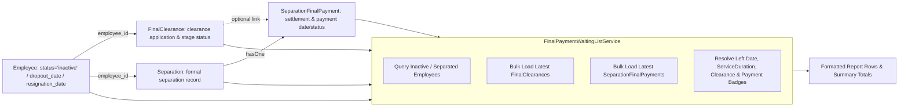

# Final Payment Waiting List Report — Specification & Implementation Plan

A comprehensive, production-grade specification for the **Final Payment Waiting List** report under the **Staff Fund** section. Like the HR staff reports, this report supports four synchronized output channels:
1. **Interactive Web Preview** (Inertia + React + Tailwind + Radix UI)
2. **Browser Print** (Blade document with CSS `@page` landscape rules, header, black borders, compact 8–9pt typography)
3. **High-Fidelity PDF Export** (Chrome Headless via Browsershot with automatic fallback to mPDF)
4. **Native Excel Export** (`.xlsx` via `SimpleXLSXGen` with headers, formatted values, column auto-widths, and summary row)

---

## 1. Report Metadata & Orientation

- **Report Title:** Final Payment Waiting List
- **Section Placement:** **STAFF FUND** (`/sections/staff-fund`)
- **Navigation Location:** Staff Fund Reports submenu in `AdminLayout.tsx` and Staff Fund Nav Group
- **Page Orientation:** **A4 Landscape** (12 detailed columns)
- **Top Corner:** **Print Date & Time** (e.g. `Print Date: 16-11-2026 01:15 PM`)
- **Duration Format:** `ServiceDuration` format: `%dY, %dM, %dD` (e.g. `1Y, 4M, 15D` or `0Y, 2M, 5D`) from Left Date to As-Of / Current Date.

---

## 2. Table Column Schema

| # | Column Name | Database Source / Resolution Logic | Formatting / Presentation |
|---|---|---|---|
| **1** | **SL No** | Sequential row counter (`1, 2, 3...`) | Centered |
| **2** | **Pin** | `employees.pin` (fallback `employees.employee_id`) | Monospace, Centered |
| **3** | **Name (English)** | `employees.name_en` | Left aligned, Medium font |
| **4** | **Designation** | `employees.last_designation_id` falling back to `designation_id` | Left aligned |
| **5** | **Left Date** | Priority: `final_clearances.dropout_date` &rarr; `separations.separation_date` &rarr; `employees.dropout_date` &rarr; `employees.resignation_date` | `d-m-Y` (e.g. `30-06-2026`), Centered |
| **6** | **Duration from Left Date** | Tenure since departure: difference between `Left Date` and `As-Of Date` (or today) via `ServiceDuration::format()` | Text (e.g. `0Y, 4M, 17D`), Centered |
| **7** | **Left Reason** | Priority: `separations.cause_of_separation` / `reason` &rarr; `employees.dropout_reason` &rarr; `employees.cause_of_separation` | Left aligned (e.g. Resignation, Dropout, Termination) |
| **8** | **Left Branch** | Priority: `final_clearances.branch` &rarr; `employees.lastBranch` &rarr; `employees.currentBranch` | Left aligned, with Branch Code |
| **9** | **Clearance Status** | Latest `final_clearances.status` for the employee: `draft`, `submitted_to_hr`, `submitted_to_accounts`, `submitted_to_director_fa`, `submitted_to_ed`, `approved`, `rejected` (or `Not Submitted` if no clearance row exists) | Status badge with humanized label & color |
| **10** | **Payment Status** | From `separation_final_payments.status` (`paid`, `pending`) or `employees.final_payment_date` (if paid without record &rarr; `Paid`, else `Waiting / Not Initiated`) | Status badge: `Paid` (Green), `Pending` (Amber), `Waiting` (Rose) |
| **11** | **Payment Date** | `separation_final_payments.payment_date` &rarr; `employees.final_payment_date` &rarr; `separations.final_payment_date` | `d-m-Y` (e.g. `24-10-2026`) or `—` if unpaid |
| **12** | **Payment Amount** | Net payable / settled amount: `separation_final_payments.net_payable` &rarr; `final_clearances.net_payable` &rarr; `employees.final_payment_amount` | Currency formatted `#,##0.00` or `—` if not yet determined |

---

## 3. Data Integration & Workflow Architecture



### Business Logic Details:
1. **Target Employee Scope:**
   Employees with `status = 'inactive'` OR having a non-null `dropout_date` or `resignation_date` OR possessing a `Separation`, `FinalClearance`, or `SeparationFinalPayment` record.
2. **Clearance Workflow Mapping:**
   `FinalClearance` records track the multi-tier approval workflow:
   - `draft` &rarr; **Draft**
   - `submitted_to_hr` &rarr; **Submitted to HR**
   - `submitted_to_accounts` &rarr; **Submitted to Accounts**
   - `submitted_to_director_fa` &rarr; **Submitted to Director (F&A)**
   - `submitted_to_ed` &rarr; **Submitted to Executive Director**
   - `approved` &rarr; **Approved**
   - `rejected` &rarr; **Rejected**
   - No record &rarr; **Not Submitted**
3. **Payment Status Mapping:**
   - If `SeparationFinalPayment::STATUS_PAID` (`'paid'`) or `employee.final_payment_date !== null` &rarr; **Paid**
   - If `SeparationFinalPayment::STATUS_PENDING` (`'pending'`) &rarr; **Pending**
   - If no payment record exists &rarr; **Waiting / Not Initiated**
4. **Summary Metric Cards (on Web Preview):**
   - Total Inactive/Separated Staff
   - Total Awaiting Payment (Pending + Waiting)
   - Total Paid
   - Total Net Payable Amount (Pending & Waiting)
   - Total Clearance Approved vs Pending vs Not Submitted

---

## 4. User Filters & Controls

The report header includes a comprehensive filter bar:
1. **As-Of Date:** (defaults to today) &mdash; base date for duration calculation.
2. **Left Date Range:** `date_from` and `date_to` &mdash; filter by departure period.
3. **Payment Status Filter:**
   - `waiting_pending`: Only staff awaiting final settlement (Default view)
   - `paid`: Only completed settlements
   - `all`: Full historical register
4. **Clearance Status Filter:**
   - All statuses
   - Approved
   - In Progress (`submitted_to_*`)
   - Draft
   - Rejected
   - Not Submitted
5. **Organogram Scope:**
   - Zone
   - Regional Office
   - Branch
6. **Search Input:**
   - PIN / Name filter

---

## 5. File Structure & Components to Create / Modify

```
app/
├── Http/Controllers/StaffFund/
│   └── FinalPaymentReportController.php             # Web preview, print, PDF, Excel actions
├── Services/
│   └── FinalPaymentWaitingListService.php          # Core bulk calculation service
├── Support/
│   └── FinalPaymentWaitingListXlsxExporter.php      # SimpleXLSXGen Excel generator
└── Models/
    └── Employee.php                                 # Add clearance & separation relations

config/
└── staff_fund_reports.php                          # Configuration & signature blocks

resources/
├── js/
│   ├── layouts/AdminLayout.tsx                     # Add report to buildReportsSubmenu('staff-fund')
│   ├── lib/staff-fund-nav.ts                       # Add report to STAFF_FUND_NAV_GROUPS
│   └── pages/staff-fund/reports/
│       └── final-payment-waiting-list.tsx          # Inertia React interactive preview
└── views/staff-fund/reports/
    ├── document.blade.php                          # Print/PDF wrapper
    └── templates/
        └── final-payment-waiting-list.blade.php    # Blade print/PDF table template

routes/
└── web/staff-fund.php                              # Web routes definition

tests/Unit/
└── FinalPaymentWaitingListTest.php                 # Comprehensive feature/unit test suite
```

---

## 6. Implementation Steps

1. **Step 1: Domain Relations on Employee Model**
   - Add `finalClearances()`, `latestFinalClearance()`, `separations()`, `latestSeparation()`, `separationFinalPayments()`, and `latestSeparationFinalPayment()` relationships to `App\Models\Employee`.

2. **Step 2: Service Layer (`FinalPaymentWaitingListService`)**
   - Implement query with eager loading for branch (zone, region), designation, and bulk preloading of latest `FinalClearance`, `Separation`, and `SeparationFinalPayment` records.
   - Implement `ServiceDuration` computation from `Left Date` to `as_of_date`.
   - Calculate summary aggregates (total staff, total amount, pending vs paid counts).

3. **Step 3: Controller & Routes**
   - Create `FinalPaymentReportController` under `App\Http\Controllers\StaffFund`.
   - Register routes under `/staff-fund/reports/final-payment-waiting-list` (`index/show`, `print`, `pdf`, `excel`) protected by `staff-fund.view` permission.

4. **Step 4: Navigation Integration**
   - Update `buildReportsSubmenu('staff-fund')` in `AdminLayout.tsx` to include `Final Payment Waiting List`.
   - Update `STAFF_FUND_NAV_GROUPS` in `staff-fund-nav.ts`.

5. **Step 5: Interactive Web Screen (`show.tsx`)**
   - Implement filter bar, summary metric cards, responsive data table with status badges (Clearance Status, Payment Status), sorting, and export action buttons.

6. **Step 6: Print & High-Fidelity PDF Template**
   - Build Blade template with CSS `@page` landscape setup, top-right print date, company header, compact table styling, alternating rows, total footers, and official signature blocks.

7. **Step 7: Excel Export (`SimpleXLSXGen`)**
   - Multi-header spreadsheet with company name, filter details, print timestamp, bold column headers, currency format on amounts, and formula/total row.

8. **Step 8: Automated Verification**
   - Unit tests covering Left Date resolution hierarchy, duration formatting (`Y, M, D`), clearance status mapping, payment status filters, and Excel/PDF generation.
   - Full TypeScript & Vite production build check (`npm run build`).
