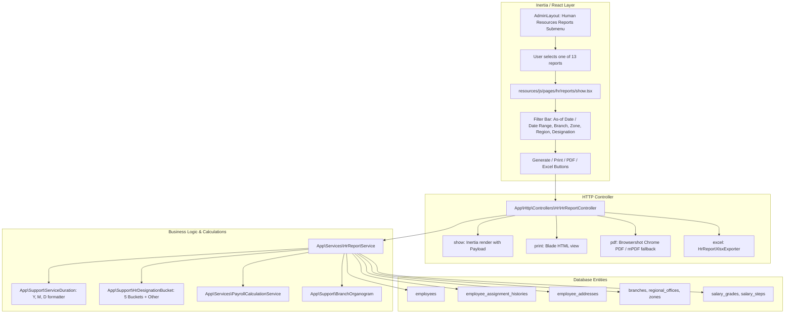

# Human Resource Staff Reports Specification & Implementation Plan

A complete, production-ready specification for 13 Human Resource staff reports. Every report supports four synchronized output modes:
1. **Interactive On-screen Preview** (Inertia + React + Tailwind + Radix UI)
2. **Browser Print** (Blade document with CSS `@page` print rules, repeating headers, black borders, compact 8–9pt typography)
3. **High-Fidelity PDF Export** (Chrome Headless via Browsershot with automatic fallback to mPDF)
4. **Excel Export** (Native `.xlsx` via `SimpleXLSXGen` with headers, formatted values, column auto-widths, and formula/total rows)

---

## 1. Page Orientation & Global Formatting Rules

- **Orientation:**
  - **Portrait (A4):** Report 1 (`Staff Report by Designation`) only.
  - **Landscape (A4):** All other 12 reports (Reports 2 through 13).
- **Duration Format:**
  - Standard format: `10Y, 6M, 29D` (always Year, Month, Day separated by comma and space).
  - Same-day tenure produces `0Y, 0M, 0D`.
  - Eligibility headers display the configured benchmark (e.g., `0Y, 3M, 00D` or `0Y, 6M, 00D`).
- **Date Format:** `d-m-Y` (e.g., `16-11-2026`). Month names where specified: `F Y` (e.g., `November 2026`).
- **Monetary Format:** Rounded to integer Taka with comma thousand separators (`#,##0`), empty/zero cells formatted cleanly.
- **Navigation Placement:** Human Resources Section (`/sections/human-resources`) under the Reports submenu inside `AdminLayout.tsx`.

---

## 2. Real Schema & Business Logic Mapping

Based on existing database schema and domain models:

### A. Employee Status & Active Set
- **Active Staff:** `employees.status IN ('active', 'on_leave')`. All "Only Active" reports strictly filter by this set.
- **Inactive Staff:** `employees.status NOT IN ('active', 'on_leave')` (e.g. `inactive`, `separated`, `resigned`, `terminated`, `retired`).
- **Report 1** reconciles both Active and Inactive headcounts.

### B. Designation Resolution
- For Active staff: `designations.name` via `employee.designation_id`.
- For Inactive staff: `designations.name` via `employee.last_designation_id`, falling back to `designation_id`.

### C. Branch, Office & Hierarchy Resolution
- For Active staff: `current_branch_id`. For Inactive staff: `last_branch_id ?? current_branch_id`.
- **Branch Label:** `[branch_code] branch_name` (e.g., `0101 Main Branch`).
- **Head Office Detection:** `branches.is_head_office = true`, branch code `'0000'`, or branch name containing `'head office'`.
- **Hierarchy:** `branches.regional_office_id` → `regional_offices` (`name`, `code`) → `zones` (`name`, `code`).
- Head office without a zone/region is grouped as its own top-level **"Head Office"** group.

### D. Joining Date & Present Location Stint
- **Overall Service Length:** From `employees.joining_date` to `Employee::getServiceEndDate()` (`dropout_date ?? resignation_date ?? today`).
- **Joining Date at Present Location:** Start date of the continuous unbroken stint at the employee's current `branch_id` from `employee_assignment_histories` (`effective_from`). If no assignment history exists for that branch, falls back to `employees.joining_date`.
- **Duration at Present Location:** From the present location joining date to `Employee::getServiceEndDate()`.

### E. Address Fields
- **Combined Present Address (Reports 2 & 3):**
  - Priority: `employee_addresses` record where `type = 'present'` (`village`, `union`, `upazila`, `district`, `address_details`).
  - Fallback: Flat employee fields (`village`, `post_office`, `union_pouroshova`, `ward_no`, `upazila`, `district`, `address`).
  - Blank parts are skipped, remaining items joined with `, `.
- **Permanent Address (Report 4 - PKSF):**
  - Priority: `employee_addresses` record where `type = 'permanent'` (`village`, `union`, `upazila`, `district`, `address_details`).
  - Fallback: Flat employee fields.

### F. Identification & Contact Details
- **Staff Mobile:** `mobile_personal ?? mobile_official`.
- **NID / Smart Card:** `nid_number ?? smart_card_number`.
- **Father's Name:** `employees.father_name`.
- **Date of Birth:** `employees.date_of_birth` formatted as `d-m-Y`.

### G. Salary & Grade Resolution
- **Grade & Step:** `salary_grades.code` + `salary_grades.name`, `salary_steps.step_number`.
- **Basic Salary:** `Employee::resolveBasicSalary()` (reflecting custom basic, assignment history, or grade structure).
- **Gross Salary:** `PayrollCalculationService::calculateForEmployee($employee, $asOfDate)['gross_salary']` (includes grade allowances, probation salary, or fixed salary packages).

### H. Sorting Order
Consistent across staff listings:
1. Head Office first, followed by branches sorted by numeric `branch_code`.
2. Within branch: Organogram designation hierarchy via `BranchOrganogram::compareBranchStaffRow`.
3. PIN ascending (natural sort).

---

## 3. Designation Buckets for Field Staff (Reports 5, 6, 7)

To ensure field summary tables maintain exact totals without missing headcount, active staff designations are folded into 5 standard buckets plus an "Other" catch-all:

1. **Officer:** Field Officer, Program Officer, Officer, Senior Officer, Assistant Branch Manager, and their non-accountant trainee/probationary designations.
2. **Accountant:** Accountant, Junior Accountant, Branch Accountant, Accountant I / II / III, and Probationary Accountant. (Explicitly excludes Accounts Officer).
3. **Branch Manager (BM):** Branch Manager and BM acronyms (excludes trainees and assistants).
4. **Regional Manager (RM):** Regional Manager and RM acronyms.
5. **Zonal Manager (ZM):** Zonal Manager and ZM acronyms.
6. **Other:** Any active field designation not matching the above 5 (ensures sum equals exact branch headcount). HO-only titles are excluded on Report 5.

---

## 4. The 13 Reports Blueprint

| # | Slug | Title | Orientation | Scope / Filters | Key Columns & Layout |
|---|------|-------|-------------|-----------------|----------------------|
| **1** | `staff-by-designation` | Staff Report by Designation | **Portrait** | Active & Inactive, As-Of Date | Designation, Active (Male, Female, Total), Inactive (Male, Female, Total), Grand Total. Grand total footer row. |
| **2** | `active-staff-all-units` | Active Staff Report (AU) | **Landscape** | All Active, As-Of Date, Branch/Zone filter | SL, Present/Joining Branch, PIN, Name (English), Present/Last Designation, Joining Date, Joining Date at Present Location, Duration at Present Location (`Y, M, D`), Mobile, Address Combined. |
| **3** | `branch-wise-active-staff` | Branch-wise Active Staff Report | **Landscape** | Active, Grouped by Branch | Same columns as #2, grouped by branch with branch staff count banner and page break between branches. |
| **4** | `branch-wise-active-staff-pksf` | Branch-wise Active Staff Report (for PKSF) | **Landscape** | Active, Grouped by Branch | Print date in top-right corner. SL, Branch, PIN, Name (English), Father's Name, Designation, Joining Date, Joining Date at Present Location (`d-m-Y`), Mobile, NID/Smart Card, DOB, Permanent Address. |
| **5** | `microfinance-field-staff-summary` | Microfinance Field Staff Summary | **Landscape** | Active only | SL, Zone, Region, Branch, Officer (M, F, T), Accountant (M, F, T), BM (M, F, T), RM (M, F, T), ZM (M, F, T), Other (M, F, T), Total (M, F, T). Followed below by Head Office Staff Summary table and Combined Grand Total (Field + Head Office). |
| **6** | `microfinance-head-office-staff-summary` | Microfinance Head Office Staff Summary | **Landscape** | Active, **Head Office Only** | Single continuous table. Columns: SL, Salary Grade, Present / Last Designation, Male, Female, Total. Grand Total footer row (no repetitive subheaders/subtotals). |
| **7** | `zone-region-wise-summary` | Zone & Region-wise Summary | **Landscape** | Active, All locations (HO as its own row) | SL, Zone, Region, Officer (M, F, T), Accountant (M, F, T), BM (M, F, T), RM (M, F, T), ZM (M, F, T), Other (M, F, T), Total (M, F, T). |
| **8** | `zone-wise-summary` | Zone Wise Summary | **Landscape** | Active, All locations (HO as its own row) | SL, Zone, Officer (M, F, T), Accountant (M, F, T), BM (M, F, T), RM (M, F, T), ZM (M, F, T), Other (M, F, T), Total (M, F, T). |
| **9** | `location-wise-summary-ratio` | Location-Wise Summary & Ratio | **Landscape** | Active staff summary | Rows: Field Staff, Head Office, Grand Total. Columns: Location, Male, Female, Total, Ratio (`Male : Female` simplified via GCD), Percentage (`Male %`, `Female %` summing to 100.0%). |
| **10** | `designation-recruitment-separation-final-payment` | Designation-wise Recruitment, Separation & Final Payment | **Landscape** | Date Range (`From Date` - `To Date`) | 3 distinct sections (Recruitment via `joining_date`, Separation via `dropout_date ?? resignation_date`, Final Payment via `final_payment_date`). Month × Active Designations grid, Month Total, Year Subtotals, and Grand Total. |
| **11** | `branch-wise-probation-salary-increase` | Branch Wise Active Staff Probation Period Salary Increase | **Landscape** | Active, Employment Type = Probation, Unconfirmed, `>= 3 months` or due within next 6 months | Eligibility Banner: `Active staff, not yet Confirmed, minimum 0Y, 3M, 00D since joining Date, Including staff becoming eligible within the next 6 months`. Columns: SL, Branch, PIN, Name, Designation, Joining Date, Service Length (`Y, M, D`), Upcoming Salary Increase Date (`joining_date + 3M`), Upcoming Month (`F Y`), Grade, Step, Basic, Gross. |
| **12** | `branch-wise-active-staff-confirmation` | Branch Wise Active Staff Confirmation Report | **Landscape** | Active, Employment Type = Probation, Unconfirmed, `>= 6 months` or due within next 6 months | Eligibility Banner: `Active staff, not yet Confirmed, minimum 0Y, 6M, 00D since joining Date, Including staff becoming eligible within the next 6 months`. Columns: Same as #11 with 6-month threshold (`joining_date + 6M`). |
| **13** | `branch-wise-active-promotion` | Branch-wise Active Promotion Report | **Landscape** | Active, Salary Grade I–XIV, `>= 2 years` since last promo/grade change or due within 6 months | Eligibility Banner: `Active staff, Salary Grade I to XIV, Minimum 2 years since last Promotion/Grade Change, Including staff becoming due within the next 6 months`. Columns: SL, Branch, PIN, Name, Designation, Joining Date, Confirmation Date, Service Length (`Y, M, D`), Last Promotion/Grade Change Anchor Date, Upcoming Promotion Date (`Anchor + 2Y`), Upcoming Month (`F Y`), Grade, Step, Basic, Gross. |

---

## 5. System Architecture & Components

### Component Details
1. **Configuration (`config/hr_reports.php`):**
   - Company title, address, signature blocks (HR, Finance, ED).
   - Report registry with metadata (slug, title, orientation, filters, template).
2. **Support Classes (`app/Support/`):**
   - `ServiceDuration`: Calculates exact difference between start and end dates and formats as `%dY, %dM, %dD`.
   - `HrDesignationBucket`: Resolves any designation name to one of `Officer`, `Accountant`, `Branch Manager`, `Regional Manager`, `Zonal Manager`, or `Other`.
   - `HrReportGrade`: Normalizes Roman numerals and numbers (`I`..`XIV`, `1`..`14`, `grade_i`..`xiv`) to detect grades 1–14.
   - `HrReportXlsxExporter`: Builds professional multi-header spreadsheets via `SimpleXLSXGen`.
3. **Core Service (`app/Services/HrReportService.php`):**
   - Bulk loads employees and related models with single-pass queries.
   - Bulk loads `employee_assignment_histories` indexed by `employee_id` to evaluate present branch stints and promotion anchor dates without N+1 queries.
   - Shared staff row builder for uniform formatting across listings.
4. **Controller (`app/Http/Controllers/Hr/HrReportController.php`):**
   - Handles `show`, `print`, `pdf`, `excel`.
   - Enforces permissions (`reports.view`, `employees.view`, `reports.export`).
5. **Views (`resources/views/hr/reports/`):**
   - `document.blade.php`: Root print/PDF layout with dynamic orientation (`A4 portrait` vs `A4 landscape`).
   - Reusable template partials for each report family.

---

## 6. Verification & Pest Test Suite

- **Unit Tests:**
  1. `ServiceDurationTest`: Verifies `15 Nov 2016` to `14 Jun 2027` format (`10Y, 6M, 29D`), same-day (`0Y, 0M, 0D`), and null handling.
  2. `HrDesignationBucketTest`: Tests matching of Field Officer, ABM, Accountant-II, Probationary Accountant, BM-1, RM, ZM, and fallback to Other.
  3. `HrReportGradeTest`: Verifies recognition of `I`, `xiv`, `Grade iv`, `14`, and rejection of `xv` (15) or null.
- **Service & Reconciliation Tests:**
  4. `StaffByDesignationTest`: Reconciles `Active (M + F + Blank) + Inactive (M + F + Blank) == Grand Total`.
  5. `LocationStintTest`: Validates that unbroken branch assignment history correctly shifts joining date at present location, with fallback to joining date.
  6. `EligibilityThresholdTest`: Tests 3-month probation increase, 6-month confirmation, and 2-year promotion eligibility windows (+6 month horizon).
  7. `MicrofinanceFieldStaffSummaryTest`: Confirms Head Office staff are completely excluded from Report 5.
  8. `LocationWiseRatioTest`: Verifies Field + Head Office = Grand Total and Male % + Female % = 100.0%.
